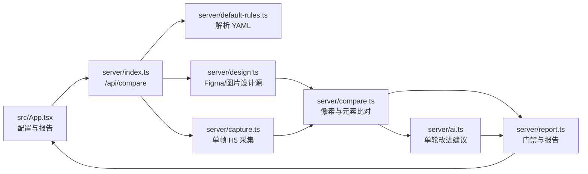
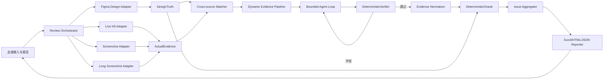

# AI UI 视觉走查：需求与技术蓝图

> 状态：讨论结论整理稿  
> 适用范围：DiffLab 从静态单页视觉比对演进为支持金融行情动态内容的 AI UI 视觉走查引擎  
> 非目标：Jira、企微通知、任务流转、研发整改闭环和业务自动化测试

## 1. 结论摘要

DiffLab 的产品定位保持为“以 Figma 为设计真值的 UI 还原度审查工具”。Agent 不验证业务逻辑，也不负责在页面中寻找目标状态；它只帮助识别动态内容、解决节点匹配歧义、选择归一化策略和解释问题。最终通过/不通过继续由可复现的确定性规则决定。

第一阶段采用以下边界：

- 一个比对单元始终是一个 Figma Frame 对应一个已经处于目标状态的开发页面；
- 一个走查任务可以批量包含多个比对单元，但每个单元独立执行一对一比对；
- 设计侧能够提供带访问权限的 Figma Frame、组件和 Variant 元数据；
- 开发侧优先同时提供 H5 URL 与实际设备截图，也支持只提供其中一种；
- H5 不强制增加 `data-figma-id`、`data-testid` 等语义属性，系统必须具备黑盒识别能力；
- 首批动态类型聚焦金融行情数值、动态列表、涨跌/平盘 Variant 和异步加载；
- 单页目标耗时为 15–20 秒，通常调用 Agent 一次，存在冲突时最多修正一次；
- 默认只审查设计稿与开发页面能够可靠匹配的交集元素；
- 结果以 Excel 为主要交付物，同时保留 JSON、HTML、Markdown 和图片证据。

## 2. 产品范围

### 2.1 目标

1. 自动读取 Figma 的页面、节点、组件、Variant 和样式参数；
2. 自动采集 H5，或读取设备截图、长截图作为实际页面证据；
3. 自动识别布局、间距、字体、颜色、圆角、图标、图片等还原差异；
4. 对金融行情动态数据进行内容归一化，同时保留对布局和样式的严格检查；
5. 自动生成包含问题位置、参数差异、修改建议、截图证据、优先级和置信度的标准化报告；
6. 降低设计人员逐页截图、测量、整理和重复确认的工作量。

### 2.2 明确不做

- 不负责 Jira 触发、任务创建和状态同步；
- 不负责企微或其他消息通知；
- 不管理开发修改、重新提测和关闭问题的流程；
- 不判断行情数据、订单、权限等业务结果是否正确；
- 不要求用户编写点击、输入、提交等自动化测试步骤；
- 第一阶段不负责在多个交互状态中自动寻找与 Figma 对应的状态；
- 第一阶段不直接解析移动端安装包内部 UI 参数。

## 3. 领域词汇

后续代码、规则和报告统一使用以下词汇：

| 词汇 | 含义 |
| --- | --- |
| 设计真值 `DesignTruth` | 由 Figma Frame、节点树、组件、Variant、样式和渲染图组成的预期视觉状态 |
| 实际证据 `ActualEvidence` | 由 H5 多帧采集、设备截图、长截图、DOM 和 computed styles 组成的开发页面证据 |
| 页面配对 `PagePair` | 一个 Figma Frame 与一个开发页面状态构成的一对一比对单元 |
| 动态区域 `DynamicRegion` | 内容会随时间或数据变化，但视觉结构应保持设计一致的页面区域 |
| 行情 Variant `MarketVariant` | 上涨、下跌、平盘等允许切换颜色或图标的设计状态 |
| 归一化策略 `NormalizationStrategy` | 在保留布局和样式检查的前提下消除合法动态内容差异的方法 |
| Agent 假设 `AgentHypothesis` | Agent 对动态类型、节点绑定或处理策略提出的结构化候选结论 |
| 确定性验证器 `DeterministicVerifier` | 用多帧、DOM、Figma 和几何证据验证 Agent 假设的代码模块 |
| 确定性审查器 `DeterministicOracle` | 执行像素和参数规则并决定问题严重级别及最终门禁的代码模块 |
| 走查问题 `ReviewIssue` | 一个元素或区域上的一个主要修改动作及其完整证据 |
| 证据置信度 `EvidenceConfidence` | 由可复现证据计算的可信程度，不采用模型自报分数 |

## 4. 比对单元与输入模式

### 4.1 页面配对

```text
PagePair
├── 一个 DesignTruth
├── 一个 ActualEvidence
├── 一个 ViewportProfile
└── 一套 AcceptanceConfig
```

多个页面通过多个 `PagePair` 批量运行：

```text
首页 Frame       ↔ H5 首页
行情列表 Frame   ↔ H5 行情列表
详情页 Frame     ↔ 详情页设备截图
```

批量能力不改变单个比对单元的一对一约束。

### 4.2 实际证据模式

| 模式 | 输入 | 正式实际图 | 动态识别证据 | 能力等级 |
| --- | --- | --- | --- | --- |
| Live | Figma + H5 URL | Playwright 截图 | DOM + 多帧截图 | 高 |
| Screenshot | Figma + 实际截图 | 实际截图 | OCR/视觉结构；多截图时包含时间变化 | 中或低 |
| Hybrid | Figma + H5 URL + 实际截图 | 实际设备截图 | DOM + 多帧 H5 + 实际截图 | 最高，默认推荐 |
| Long Screenshot | Figma 长图 + 开发长截图 | 分片后的开发长截图 | 图像结构；有 URL 时可叠加 DOM | 取决于对齐质量 |

Hybrid 模式中，Figma 是预期真值，设备截图是正式实际结果，H5 URL 用于补充 DOM、样式、列表结构和多帧动态证据。只有当 H5 采集图与设备截图的页面结构和几何锚点可靠对齐时，才允许把 DOM 区域投影到设备截图。

若 H5 不可访问或对齐失败，自动降级到 Screenshot 模式，并降低依赖 DOM 的结论置信度。

## 5. 当前系统地图

当前实现是一条同步的单帧流水线：



### 5.1 现有模块与调用者

| 模块 | 直接调用者 | 当前职责 | 对目标能力的限制 |
| --- | --- | --- | --- |
| `src/App.tsx` | 浏览器用户 | 收集一个设计源、一个 H5 URL 和 YAML，展示报告 | 不支持实际截图、批量 PagePair 和 Excel |
| `server/index.ts` | `src/App.tsx` | 串联规则、设计、采集、比对、AI 和报告 | 一次请求只有一次采集和一次比对 |
| `server/design.ts` | `server/index.ts`、`server/demo.ts` | 读取 Figma 或上传图片，生成 `DesignSource` | Figma 节点被展平，缺少父子结构、组件和 Variant 语义 |
| `server/capture.ts` | `server/index.ts`、`server/demo.ts` | 创建浏览器、等待稳定、截取首屏、提取 DOM 和静态问题 | 只返回一个 `PageCapture`，动态变化被视为噪声 |
| `server/compare.ts` | `server/index.ts`、`server/demo.ts` | 像素比对、节点匹配、参数规则和问题排序 | 动态文本会破坏文本匹配和整体像素相似度 |
| `server/ai.ts` | `server/index.ts` | 根据最终截图和已有问题生成一次建议 | 不观察多帧，也不验证自己的判断 |
| `server/report.ts` | `server/index.ts` | 根据 `error` 数量决定状态，生成 HTML/Markdown | 没有 Excel、动态证据、问题归并和置信度说明 |
| `server/default-rules.ts` | `server/index.ts` | 解析默认阈值、严重级别和忽略选择器 | 没有输入模式、动态策略和证据置信度配置 |
| `src/types.ts` | 前端及全部服务端模块 | 定义共享配置、元素、问题和报告模型 | 数据模型只表达展平元素与单张截图 |

### 5.2 应继续保留的原则

- Figma 或基准图片是设计真值；
- 固定 viewport、DPR、色彩模式和字体等待条件；
- AI 不决定通过/不通过；
- `error` 才阻断验收，低置信度问题降级为 `pending`；
- 报告必须保留设计图、实际图、差异图、参数和定位证据。

## 6. 目标系统地图

目标架构保持现有主干，并在实际证据与确定性比对之间加入动态证据层：



### 6.1 责任边界

Agent 负责：

- 分类动态文本、动态列表和行情 Variant；
- 处理 Figma 节点与黑盒 DOM 的歧义绑定；
- 为候选动态区域提出归一化策略；
- 在确定性验证失败后缩小范围或放弃假设；
- 将底层差异归并为人能理解的修改项；
- 生成差异说明、修改建议和建议优先级。

Agent 不负责：

- 点击、输入或寻找与 Figma 对应的页面状态；
- 判断行情数据或业务结果是否正确；
- 自行扩大动态忽略区域；
- 在没有设计证据时发明合法颜色或图标；
- 直接改变通过/不通过结论。

## 7. 单个页面配对的生命周期

1. 解析 YAML，得到采集、动态识别、置信度和参数规则；
2. 从 Figma 构建 `DesignTruth`：渲染图、节点树、组件、Variant、Auto Layout 和样式；
3. 根据 Live、Screenshot、Hybrid 或 Long Screenshot 模式构建 `ActualEvidence`；
4. 对 H5 连续采集 3–5 帧，记录截图、DOM、computed styles、文字和几何变化；
5. 建立 Figma 节点与开发元素的候选绑定；
6. 生成像素方差图，结合 DOM 变化和重复结构找出动态区域；
7. Agent 对歧义区域输出结构化 `AgentHypothesis`；
8. `DeterministicVerifier` 在全部样本中验证选择器、几何、样式、Figma 绑定和处理范围；
9. 验证失败时允许 Agent 修正一次，仍然不确定则标记 `pending`；
10. 对稳定区域执行像素比对，对动态区域执行内容归一化后的结构和参数比对；
11. 将同一根因产生的像素、位置、字体和图标差异归并为一个 `ReviewIssue`；
12. 生成 Excel、局部红框图、HTML、JSON、Markdown 和诊断证据。

建议的 15–20 秒预算：

| 阶段 | 目标耗时 |
| --- | ---: |
| 页面加载与稳定 | 5–8 秒 |
| 多帧采样 | 3–5 秒 |
| Agent 分类 | 3–5 秒 |
| 确定性验证、比对和报告 | 2–3 秒 |

## 8. 跨源元素匹配

H5 不保证提供语义标记，因此匹配必须采用分层证据：

1. 精确标记：存在时使用 `data-figma-id` 或稳定测试标记；
2. 稳定文本：标题、表头、按钮等不随行情变化的文字；
3. Figma 组件关系：Component、Instance、Variant 和父子节点；
4. DOM 结构：tag、role、父子路径、相邻元素和重复子树；
5. 几何特征：位置、尺寸、IoU、对齐和列结构；
6. 样式特征：字体、颜色、边框、圆角和背景；
7. 多帧轨迹：DOM 身份稳定，但文字内容持续变化；
8. Agent 推断：仅用于上述证据仍有歧义的情况。

运行时元素不能只靠 CSS selector 标识，应生成稳定指纹：

```text
RuntimeElementFingerprint
= tag/role
+ 祖先结构摘要
+ 页面区域
+ 相对几何
+ 样式摘要
+ 相邻元素关系
+ 多帧变化轨迹
```

## 9. 金融行情动态内容

### 9.1 行情数值

价格、涨跌额、涨跌幅、成交量等具体数据允许变化。系统忽略字符内容，但继续检查：

- 元素位置、尺寸和对齐；
- 字体、字号、字重、行高和字距；
- 数字位数变化后的溢出、裁切和邻近元素挤压；
- 刷新过程中的布局抖动；
- 与涨跌状态相关的颜色、图标和背景 Variant。

只有当同一元素在至少三次样本中满足“内容变化、DOM 身份稳定、位置与容器稳定”时，才可以自动认定为动态行情值。

### 9.2 行情列表

列表按视觉模板审查，不按具体数据逐行、逐字比较：

```text
行情列表
├── 表头模板
├── 行模板 × N
│   ├── 标的名称
│   ├── 最新价
│   ├── 涨跌额
│   └── 涨跌幅
└── 分页/加载区域
```

不参与门禁的内容：

- 行情具体数值；
- 默认行数；
- 因实时行情产生的自然排序。

继续严格检查：

- 列表容器、表头、列数和列宽；
- 行高、间距、分割线和背景；
- 每列的对齐方式；
- 行内元素结构；
- 长名称、长数字下的布局稳定性；
- 涨跌 Variant；
- 滚动、分页和加载区域是否产生遮挡或溢出。

### 9.3 涨跌/平盘 Variant

Figma 不强制使用统一英文命名。系统通过属性和值、节点颜色、图标形状、示例文本符号和组件关系，将不同命名归一成内部状态：

```text
market.up
market.down
market.flat
```

若只能区分多个视觉状态但不能可靠判断业务语义，则使用 `variant-A/B/C`，仍可检查视觉一致性，但报告不得声称其代表涨、跌或平盘。

合法 Variant 的证据优先级：

1. 当前 Figma Frame 中的多个行情样本；
2. Figma 组件 Variant、Variables 和共享样式；
3. 调用方显式提供的设计 Token；
4. 没有设计侧证据时标记 `pending`。

不允许仅从线上实现反推“线上使用的颜色就是正确颜色”，也不硬编码红涨绿跌或绿涨红跌。

### 9.4 异步加载

- 等待主要内容或列表进入稳定状态；
- Loading 在超时内结束后再进入正式采样；
- 持续 Loading、骨架屏未消失或布局持续变化时标记 `pending`；
- Agent 不点击页面或执行提交操作来改变状态。

## 10. 动态 Agent Loop 与置信度

### 10.1 有上限的自适应循环

```text
采集证据
→ Agent 分类与提出策略
→ 确定性反证验证
→ 验证通过则停止
→ 存在冲突时修正一次
→ 仍不确定则 pending
```

多轮的目的不是重复询问模型，而是让 Agent 的假设接受独立证据验证。通常只调用 Agent 一次，第二次仅处理验证失败的区域。

### 10.2 置信度证据

`EvidenceConfidence` 至少由以下因素组成：

- 时间采样一致性；
- DOM 身份和元素指纹稳定性；
- Figma 节点、组件或 Variant 对应度；
- 父子结构与重复模板一致性；
- 几何和样式稳定性；
- 归一化前后差异是否只减少在目标区域；
- 第二次采集是否能复现同样的分类。

建议门槛：

| 置信度 | 行为 |
| --- | --- |
| `>= 0.90` | 自动应用动态策略，可生成确定性参数问题 |
| `0.75–0.90` | 展示原始与归一化证据，问题标记为 `pending` |
| `< 0.75` | 不自动归一化，只保留原始区域差异 |
| 只有模型判断 | 最高限制为低置信度，不允许改变门禁 |

建议的证据上限：

| 匹配依据 | 最高置信度 |
| --- | ---: |
| 显式语义属性 + Figma 节点 | 0.99 |
| 多帧 DOM 指纹 + Figma 结构 + 几何稳定 | 0.95 |
| 重复结构 + 几何 + 样式 | 0.88 |
| 单帧 DOM/视觉推断 | 0.70 |
| 只有模型判断 | 0.49 |

## 11. 确定性走查规则

默认采用交集比对：

```text
可审查元素 = Figma 元素 ∩ 开发页面元素
```

- 双方可靠匹配的元素执行参数与像素规则；
- Figma 存在、开发页面不存在的元素默认忽略；
- 开发页面存在、Figma 不存在的元素默认忽略，可保留诊断统计；
- 低置信度绑定不得生成确定性参数结论；
- 动态内容不同但结构一致时进入动态归一化，不判定为缺失。

### 11.1 比对项

| 比对项 | 参数或算法 |
| --- | --- |
| 布局 | 元素 X/Y、宽高、父容器内相对位置 |
| 间距 | padding、Auto Layout gap、相邻元素距离 |
| 对齐 | 边缘、水平/垂直中心、文字基线、列对齐 |
| 字体 | font family 及实际回退字体 |
| 字号/字重 | font size、font weight |
| 排版 | line height、letter spacing、文本裁切 |
| 颜色 | 文字、背景和边框颜色的 Delta E |
| 圆角/边框 | 各方向 radius、border width、border color |
| 阴影 | offset、blur、spread、color、opacity |
| 图标 | 包围框、颜色、轮廓/形状相似度、描边 |
| 图片 | 比例、裁切、object-fit、区域感知相似度 |
| 按钮 | 容器、文字、图标、内部间距的组合检查 |
| 整体视觉 | 排除已验证动态像素后的稳定区域相似度 |

文字区域使用参数比较为主、文字栅格像素为辅，避免不同浏览器或设备的抗锯齿差异制造误报。

### 11.2 建议规则结构

```yaml
scope:
  mode: intersection_only
  report_unmatched_as: ignore

actual_source:
  preferred: hybrid
  screenshot_is_canonical: true

capture:
  samples: 5
  sample_interval_ms: 750
  timeout_ms: 20000
  full_page: false

dynamic:
  auto_detect: true
  supported:
    - market_value
    - market_list
    - market_variant
    - async_loading
  max_auto_excluded_area_ratio: 0.30
  unresolved: pending

confidence:
  auto_apply_min: 0.90
  pending_min: 0.75
  visual_only_max: 0.70
  ai_only_max: 0.49

rules:
  visual_similarity: error
  position: error
  size: error
  spacing: error
  alignment: error
  typography: error
  color: warning
  decoration: warning
  icon: error
  image: warning
  overflow: error
```

稳定区域像素相似度、动态区域结构相似度、动态区域占比和未确认区域数需要分别报告，不能通过扩大动态遮罩来提高一个总分。

## 12. 截图与长截图

### 12.1 单张截图

单张截图没有 DOM 和时间变化证据，只能使用 Figma 元数据、OCR、视觉文本区域、数字格式、重复结构和几何匹配。无法可靠区分合法动态内容与真实文字错误时必须降级为 `pending`。

难以采集 H5 时，建议同一设备、同一页面状态提供连续 2–3 张截图。多张截图可以直接暴露行情动态区域，显著提高识别置信度。

### 12.2 长截图

长截图不能缩放到一个普通 Frame 后直接比较，应执行：

1. 去除设备状态栏、浏览器栏和安全区；
2. 识别稳定标题、表头和内容锚点；
3. 按目标 viewport 分片；
4. 识别吸顶元素，避免重复计算；
5. 处理滚动懒加载和拼接空白；
6. 分片执行动态归一化和像素比对；
7. 汇总整页结果。

问题证据同时记录长图绝对坐标、所属区域、滚动位置和 Figma 节点。

## 13. 问题归并、优先级与报告

### 13.1 问题归并

底层检测结果不直接逐条输出 Excel。一个按钮整体偏移可能同时触发像素、位置、文字和图标差异，最终应归并为一个主要修改动作：

```text
问题：主操作按钮整体向下偏移 8px
影响：按钮容器、文字和图标
主要规则：position
关联证据：pixel、alignment、icon-position
```

Agent 可以生成归并和说明建议，但归并后的每个参数必须能追溯到确定性证据。

### 13.2 优先级

| 优先级 | 建议含义 |
| --- | --- |
| P0 | 页面白屏、主体无法识别、整体布局严重错误 |
| P1 | 核心区域明显偏移、关键图片/图标错误、严重遮挡 |
| P2 | 局部字号、颜色、间距、圆角和阴影差异 |
| Pending | 匹配、动态分类或截图对齐证据不足 |

### 13.3 Excel 交付物

文件名：`{走查项目名称}UI走查结果.xlsx`

主表字段：

| 字段 | 内容 |
| --- | --- |
| 序号 | 问题编号 |
| 页面名称 | Figma Frame/页面名称 |
| 差异位置 | 页面区域、组件名称或列表列名 |
| 设计稿表现 | Figma 参数 |
| 开发表现 | DOM、截图或视觉识别参数 |
| 修改内容 | 可执行修改建议 |
| 设计稿图 | 局部裁剪图，红框标记 |
| 开发图 | 局部裁剪图，红框标记 |
| 优先级 | P0/P1/P2/Pending |

技术辅助字段：规则类型、匹配置信度、Figma Node ID、开发侧元素指纹或选择器、动态策略和实际证据模式。

建议工作表：

1. `走查结果`
2. `页面汇总`
3. `运行信息`
4. `规则快照`

## 14. 目标模块与调用关系

建议以演进方式调整现有模块，不推翻当前比对核心。

### 14.1 共享模型

`src/types.ts` 增加：

- `PagePair`
- `DesignTruth`
- `ActualSource`
- `ActualEvidence`
- `CaptureSample`
- `RuntimeElementFingerprint`
- `DynamicRegion`
- `MarketVariant`
- `AgentHypothesis`
- `EvidenceConfidence`
- `ReviewIssue`

所有服务端模块和前端报告都依赖这些共享模型。

### 14.2 设计输入

`server/design.ts` 从 `DesignSource` 演进为 `DesignTruth` 构建器：

- 保留节点父子关系；
- 提取 Component、Instance 和 Variant；
- 保留 Auto Layout、文字样式、图标和图片信息；
- 输出 Figma 节点渲染区域，而不只展平为无层级元素。

调用者：`server/index.ts` 或新的 `server/review.ts`。

### 14.3 实际证据适配器

建议新增：

- `server/actual/live.ts`：H5 浏览器采集与多帧 DOM 观察；
- `server/actual/screenshot.ts`：设备截图规范化与元数据校验；
- `server/actual/long-screenshot.ts`：长截图去边框、锚点对齐和分片；
- `server/actual/hybrid.ts`：H5 与设备截图配准、DOM 区域投影。

这些适配器统一输出 `ActualEvidence`，下游不再区分输入来源。

现有 `server/capture.ts` 可先拆分为 `BrowserSession`、`CaptureSampler`、`DomObserver` 和静态审计模块，再逐步迁移到 `server/actual/live.ts`。

### 14.4 动态证据层

建议新增：

- `server/dynamic/detector.ts`：像素方差、DOM 变化和重复结构候选；
- `server/dynamic/market.ts`：行情数值、列表和 Variant 的确定性特征；
- `server/dynamic/agent.ts`：生成结构化 Agent 假设；
- `server/dynamic/verifier.ts`：跨帧反证验证、置信度和范围保护；
- `server/dynamic/normalizer.ts`：应用已经验证的归一化策略。

调用链：

```text
review.ts
→ detector.ts
→ market.ts
→ agent.ts（只处理歧义）
→ verifier.ts
→ normalizer.ts
→ compare.ts
```

### 14.5 比对与报告

`server/compare.ts` 继续作为 `DeterministicOracle`，扩展：

- 稳定区域像素相似度；
- 动态区域结构相似度；
- 父子结构、间距、对齐、图标、图片和阴影检查；
- 交集比对策略；
- 每个底层差异的证据来源和置信度。

建议新增：

- `server/issues.ts`：按根因和修改动作归并底层差异；
- `server/excel.ts`：生成包含红框截图的 Excel；
- `server/review.ts`：编排一个 `PagePair` 的完整生命周期。

`server/report.ts` 继续负责状态、HTML、Markdown 和 JSON，并消费已经归并的 `ReviewIssue`。

### 14.6 顶层调用图

```text
src/App.tsx
  → server/index.ts
    → server/review.ts
      → server/default-rules.ts
      → server/design.ts
      → server/actual/*
      → server/matcher.ts
      → server/dynamic/*
      → server/compare.ts
      → server/issues.ts
      → server/report.ts
      → server/excel.ts
```

`server/index.ts` 应收敛为 HTTP 参数校验与响应边界；业务编排移动到 `server/review.ts`，以便未来从 CLI、MCP 或批处理任务复用同一走查核心。

## 15. 公共服务接口

走查能力需要向研发平台、测试平台、CI 和其他内部服务提供稳定公共接口。公共接口采用版本化、异步任务模型：

```text
POST /v1/reviews                   创建走查任务
GET  /v1/reviews/{reviewId}        查询执行状态
GET  /v1/reviews/{reviewId}/result 获取结构化结果
GET  /v1/reviews/{reviewId}/artifacts 获取 Excel 和图片制品
```

外部调用方提交一个或多个 `PagePair`，服务返回 `202 Accepted` 与 `reviewId`。任务完成后，调用方通过查询或签名 Webhook 获取结果。`succeeded/failed` 表示任务执行状态，UI 验收结论单独使用 `passed/failed/needs_review`，避免把执行成功与验收通过混为一谈。

公共 API、Web UI、MCP 和未来 CLI 必须复用同一个 `ReviewService`，不能各自实现比对逻辑。公共部署还必须补齐服务鉴权、幂等、稳定错误码、租户隔离、密钥引用、URL 网络边界、限流、任务存储和制品存储。

详细接口草案见 [公共服务 API 设计](./PUBLIC_API_DESIGN.md)。当前 `/api/compare` 仍是无鉴权、本地同步原型接口，不能直接暴露给其他服务。

## 16. 公共 MCP 服务边界

若将走查核心暴露为公共 MCP 服务，MCP 只作为薄适配层：

```text
MCP Client
→ MCP Review Tool
→ server/review.ts
→ 同一套设计、证据、动态和确定性比对核心
```

公共能力沉淀为通用识别器、行情动态模式和规则模板，不保存客户业务数据作为公共知识。Figma 文件、H5 DOM、设备截图和审查证据默认保持项目或租户私有。

MCP 不应引入业务流程、测试用例编排或模型直接门禁，也不应形成另一套独立比对实现。

## 17. 第一阶段交付范围

### 17.1 必须完成

- 批量接收多个页面配对，每个配对保持一对一；
- 支持 Figma + H5、Figma +截图、Hybrid 三种模式；
- 从 Figma 保留节点树、组件和 Variant 证据；
- H5 连续采集 3–5 帧；
- 黑盒识别动态行情数值和重复列表；
- 识别上涨、下跌和平盘 Variant，不依赖统一英文命名；
- 动态数值变化不产生字符级误报；
- 动态元素仍检查布局、字体、颜色、图标、溢出和抖动；
- Agent 假设接受确定性验证，并按置信度决定采用或 `pending`；
- 默认采用交集比对；
- 输出归并问题、局部红框图和 Excel；
- 正常单页审查控制在 15–20 秒。

### 17.2 后续能力

- 长截图稳定分片与吸顶区域处理；
- iOS、Android、鸿蒙和小程序的原生采集适配器；
- 多 Frame 与多运行时状态的自动匹配；
- Agent 在页面中寻找目标视觉状态；
- 历史结果、规则版本和跨任务知识沉淀；
- 版本化公共 HTTP API、异步任务、Webhook 和制品存储；
- 多租户 MCP 服务和组织级通用规则库。

## 18. 成功指标

上线前使用真实金融 H5 样本建立人工标注集，至少评估：

- 动态区域识别准确率；
- 动态区域识别召回率；
- UI 问题误报率与漏报率；
- Figma/开发元素正确匹配率；
- 行情 Variant 正确映射率；
- `pending` 占比；
- 同一页面重复运行的一致性；
- 单页平均和 P95 审查时延；
- 单页人工走查耗时下降比例；
- 设计人员保留、删除和修改 AI 问题的比例。

模型效果不能只看报告是否“说得合理”，必须与设计人员人工标注的真实问题集比较。

## 19. 当前原型到目标能力的最短路径

1. 扩展共享类型和 Figma 结构模型；
2. 将单帧 `capturePage()` 改造成多帧 `ActualEvidence` 采集；
3. 实现像素方差图、动态文字检测和重复列表识别；
4. 引入结构化 Agent 假设与确定性验证器；
5. 让 `compare.ts` 支持稳定区域与动态区域分开计分；
6. 实现交集比对和低置信度降级；
7. 实现问题归并、红框局部图和 Excel；
8. 用真实金融 H5 样本校准阈值，再决定是否扩展长截图和移动端。

这条路径保留了当前原型已经验证的设计输入、Playwright 采集、像素比对、参数规则和报告基础，同时把新增复杂度限定在动态证据层。
