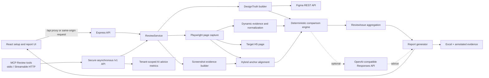

# DiffLab Architecture and Comparison Pipeline

[简体中文](./ARCHITECTURE.md) | [English](./ARCHITECTURE.en.md)

This document describes the runtime components, data flow, comparison algorithm, and known boundaries of the current prototype. The implementation in `src/` and `server/` is authoritative.

## Components



| Layer | Main files | Responsibility |
| --- | --- | --- |
| Frontend | `src/App.tsx`, `src/styles.css` | Collect inputs, edit rules, call APIs, display and export reports |
| API adapter | `server/index.ts` | Routes, upload limits, and conversion from HTTP fields to review inputs |
| Public API | `server/public-api.ts` | Service identity, asset validation, idempotent batches, progress/quotas, tenant isolation, network policy, and signed transfers |
| AI advice monitoring | `server/ai-advice-monitor.ts` | Aggregate fixed rejection codes, timeout and dangling-evidence ratios, and low-cardinality alert state per tenant |
| MCP adapter | `server/mcp.ts`, `server/mcp-stdio.ts`, `server/mcp-http.ts` | Forward four MCP Review tools to `/v1` over stdio or stateless Streamable HTTP under the caller's service identity, without duplicating review logic |
| Webhooks | `server/webhook.ts` | Build stable event bodies and HMAC signatures, apply bounded exponential retry, and record delivery outcomes |
| Review service | `server/review.ts` | Orchestrate design loading, capture, comparison, optional AI, and reporting without depending on HTTP |
| Design truth | `server/design.ts` | Build a rendered image, recursive node tree, component/Variant, layout, and style evidence from a Figma Frame |
| Page capture | `server/capture.ts` | Fix the browser environment, wait for stability, capture a screenshot, and extract DOM parent links, subtree signatures, and static findings |
| Screenshot evidence | `server/screenshot.ts` | Validate PNG/JPEG/WebP, device viewport, DPR, orientation, and crop metadata, then derive multi-image variance evidence |
| Long-screenshot evidence | `server/long-screenshot.ts` | Validate the effective content area, tile at the target viewport, detect sticky copies/lazy blanks/stitch seams, and aggregate findings to full-page coordinates |
| Hybrid evidence | `server/hybrid.ts` | Fit screenshot visual anchors to Live DOM anchors, project DOM only when reliable, and otherwise degrade safely |
| Dynamic evidence | `server/dynamic.ts` | Verify one market value from multi-frame trajectories and produce a narrowly scoped symmetric normalization strategy |
| Market lists | `server/market-list.ts` | Combine the Figma header/row hierarchy with repeated DOM subtrees to produce template bindings and deterministic list evidence |
| Market states | `server/market-variant.ts` | Map design-backed market Variants and check target colors and icons |
| Rule parsing | `server/default-rules.ts` | YAML parsing, defaults, range clamping, and rule severities |
| Comparison engine | `server/compare.ts` | Pixel diff, node matching, property comparison, and issue ordering |
| Issue aggregation | `server/review-issue.ts` | Aggregate low-level differences by region, element, and cause; assign priority; constrain Agent wording rewrites |
| AI advice | `server/ai.ts` | List models; provide only final ReviewIssues and verified matched regions to the Responses API; validate evidence references and assemble advice deterministically |
| Reporting | `server/report.ts` | Compute final status and generate UI data, Markdown, and standalone HTML |
| Excel artifacts | `server/excel-report.ts` | Generate paired annotated crops, issue rows, a Page Alignment evidence index, page summary, run information, and effective-rule snapshots |
| Shared models | `src/types.ts` | Configuration, element, issue, and report types shared by client and server |

## Lifecycle of a real comparison

1. A caller selects Live, Screenshot, Hybrid, or Long Screenshot PagePairs. Both `ReviewService` and `/v1` can batch all four modes; screenshot inputs reference validated same-tenant assets.
2. `ReviewService` parses the YAML. Missing values use defaults and out-of-range numeric values are clamped; the built-in demo calls the same service.
3. The DesignTruth builder reads the target Frame, renders a PNG at scale 1, and preserves the recursive node tree, parent relationships, Frame-relative and parent-relative geometry, Component/Instance/Variant metadata, Auto Layout, style evidence, and Figma resource catalogs.
4. If the rules specify an explicit viewport, the render viewport and both forms of relative geometry across the whole node tree are scaled independently on the X and Y axes.
5. Playwright captures Live evidence; Screenshot validates device metadata and normalizes images; Hybrid captures H5 at the device viewport and fits stable title, navigation, and header anchors; Long Screenshot tiles at one-screen viewport boundaries while retaining full-page coordinates.
6. Live captures 1–5 frames from one session. Screenshot accepts one or more images; image variance alone never auto-ignores unverified dynamic text. Hybrid projects DOM only with high-confidence alignment and otherwise degrades to Screenshot.
7. The comparison engine matches elements and recognizes market-list templates. It binds repeated row cells by column, reuses multi-frame market-value normalization and MarketVariants, then deterministically checks headers, columns, rows, gaps, dividers, and alignment.
8. Low-level differences are aggregated into ReviewIssues. A visual region may support a deterministic element issue, and shared displacement inside one `PageAlignmentPlan` module becomes one module root cause; different rules and local deviations remain separate. Agent rewriting cannot introduce unsupported parameters.
9. A page report derives `passed` or `failed` solely from `error` findings. The batch layer adds `needs_review` for pending evidence and keeps execution status separate from UI verdict.
10. The Excel generator emits one action row per ReviewIssue, paired design/actual crops with the same bounds, a Page Alignment evidence index, and page, run, and rule summaries. Issue and alignment rows expose `review-issue:*` and `page-alignment:*` indexes respectively; long-page rows also expose tile, scroll, and absolute coordinates.

## Reproducible capture environment

Every capture fixes the following conditions:

- The viewport comes from the design PNG dimensions or an explicit YAML override;
- `deviceScaleFactor: 1`;
- `colorScheme: light`;
- `reducedMotion: reduce`;
- CSS disables animation, transitions, smooth scrolling, and the caret;
- Only the current viewport is captured, not the full page;
- The launcher tries local Google Chrome first and falls back to Playwright Chromium.

After `domcontentloaded`, the capture waits for fonts and images. Layout stabilization compares up to five DOM geometry snapshots with `settle_ms` between attempts. If the page never stabilizes, capture does not wait for “perfect stability”; it continues sampling within the total `timeout_ms` budget.

The default captures three frames from the same browser context, page, and document, separated by `sample_interval_ms`. Each element receives a stable Figma-id or DOM-structure fingerprint plus its parent selector, sibling index, and a bounded text-independent subtree signature. The evidence also includes cross-frame text/geometry/style changes and a pixel variance map.

## Market-list templates

`server/market-list.ts` first identifies the DesignTruth header and row-template hierarchy, then requires at least two isomorphic direct DOM subtrees inside the bound actual container. Once verified, concrete data, natural ordering, and reasonable row counts are non-gating; header height, stable column count, column width, row height, row gap, dividers, and alignment remain deterministic checks. Every actual row cell binds to the same Figma template column, so row values reuse `normalize-market-value-text` and row states reuse MarketVariant.

Long names and numbers remain subject to `clipped_text`, `horizontal_overflow`, and column-width checks. A single row, unstable repetition, or inconsistent row column counts disables template normalization, keeps ordinary element-level review, and emits `market_list_structure/pending`.

## DynamicRegion verification and NormalizationPlan

`server/dynamic.ts` handles individual elements already bound reliably to a Figma node and concentrates DynamicRegion candidate discovery, AgentHypothesis schema validation, and the type-specific DeterministicVerifier. Candidate kinds include market values, date-time values, countdowns, and probabilities; ordinary static copy never reaches the Agent. At least three samples must prove presence, stable identity, geometry, and style, while design and actual observations must belong to the proposed deterministic semantic value family.

A verified candidate produces a DynamicRegion scoped to the exact text node. `server/normalization-plan.ts` converts all verified DynamicRegions into the DeterministicOracle's property-level comparison policy: only character pixels and `content` become non-comparable, while position, size, typography, color, decoration, overflow, and structure remain checked. Failure, timeout, invalid output, or a type conflict preserves the original `content` issue and adds `pending`; normalization never expands into a parent container, adjacent text, or a list.

Valid selectors in `ignore` receive `visibility: hidden` before the screenshot and are excluded from DOM extraction and static audits. An invalid selector does not fail the run; it is recorded in diagnostics.

## Pixel comparison

The reference image and actual capture are resized to the same integer viewport and converted to RGBA. Verified dynamic regions are cleared symmetrically from their design and actual boxes before `pixelmatch`. The full diff remains a localization aid, while gate similarity counts only the remaining stable pixels inside reliable matches:

- `pixel_threshold` controls how sensitive an individual pixel is to color difference;
- Antialiasing differences are excluded;
- `stableSimilarity = 1 - stableChangedPixels / stablePixels`; it is `1` when no reliably matched stable pixels remain;
- Unchanged pixels are transparent in the diff image;
- Changed pixels are assigned to a 24–64 px grid, and eight-directionally adjacent cells are merged. Regions with at least 18 changed pixels become fixed `pending` findings with a `0.70` visual-only confidence cap; only the top eight by changed-pixel count are kept.

`visual_similarity_min` and `rules.visual_similarity` together determine whether stable-region similarity triggers a gate finding. The compatibility field `similarity` currently equals `stableSimilarity`; dynamic-region coverage is never blended into this score.

Without DOM, Screenshot mode reviews pixels across the whole design Frame. Pure visual regions and OCR/visual-anchor matches are capped at `0.82`, so inferred parameter findings remain `pending`. Hybrid always uses the device screenshot as the formal actual image; projected DOM matches and parameter findings add `geometric-alignment` evidence and are capped by alignment confidence.

## Element matching

The comparator derives up to 1,200 comparable nodes from the DesignTruth tree, then performs one-to-one DOM matching in this order:

1. **Exact id:** `data-figma-id` matches the Figma node id with `0.99` EvidenceConfidence; hyphens and colons are normalized.
2. **Stable text:** normalized text matches after whitespace and case normalization, then center distance, size, and type refine confidence; both stable-text and structure-geometry evidence are recorded.
3. **Geometry heuristic:** center distance, size similarity, and type compatibility produce a score; only scores at or above `match_confidence_min` are accepted.

Exact ids and unique stable text first establish deterministic module anchors. When multi-sample `elementChanges` evidence is available, a displacement anchor must be present in every frame with stable text, geometry, and style. Known carousel, countdown, live-market, date, and probability semantics are excluded even when they happen not to change during a short capture. When the stable set contains at least two heading, header, navigation, card, or container anchors, those structural anchors take precedence and ordinary stable content becomes fallback evidence. A parent module named “Live market” does not disqualify its stable title or headers.

The filtered anchors use deterministic RANSAC-style consensus: every observed offset is evaluated against inliers within `position_tolerance_px`, and only a strict majority publishes the coordinate-wise median of those inliers. Without majority consensus the module correspondence may remain matched, but `displacement` is omitted so a single title or dynamic element cannot skew the module. Every region also exposes `anchorStats`: candidate, stable, dynamically excluded, and structural anchor counts, RANSAC inlier count, and RMS residual against the final median displacement. Single-frame behavior remains compatible when no temporal change summary is available.

When unmatched candidates remain and the Agent is enabled, the comparator sends both images, candidate hierarchy context, and those anchors to the model. The model must return a structured `PageAlignmentPlan` before element bindings. Region states are `matched / missing-in-actual / uncertain` and may propose a whole-region displacement. Deterministic verification accepts only in-candidate, one-to-one, non-conflicting proposals with complete evidence and confidence at or above `0.65`; Agent-derived evidence is capped at `0.82`. A model-proposed displacement is never copied directly into the final plan. It is recomputed from stable geometry only when at least two verified element bindings in the same Agent region form an inlier consensus; otherwise the displacement is removed.

The comparator tracks Agent invocation, successful response, and the business modules that contain deterministically accepted bindings as distinct states. The design scope is the top-level business module beneath the root Frame, with the actual parent container as a secondary boundary signal. A successful response with zero valid bindings does not globally disable deterministic semantic fallback. A design-supported dynamic-value candidate that is present in at least three samples, actually changes text, and keeps geometry and style stable may continue through geometry-threshold and module-boundary verification. Static numeric conflicts, ordinary text conflicts, and candidates crossing a verified module boundary remain unmatched. A valid Agent binding tightens remaining text-conflicting candidates only in its own module and cannot disable safe dynamic fallback in sibling modules.

Review JSON persists this state under `matching.semanticAgent`: page-level invocation/response flags and total accepted bindings, plus each Agent-evaluated top-level module's accepted-binding count, related actual parent containers, and dynamic-fallback decisions. To bound artifact size, only the highest-geometry-score candidate decision is retained per design node. `result` states whether fallback ultimately produced a match, while `reasonCode` distinguishes an existing valid module binding, unsupported dynamic semantics, insufficient or unstable temporal evidence, a verified module boundary, insufficient geometry confidence, and one-to-one competition. Long-screenshot reports merge tile state and deduplicate identical decisions.

A verified `matched` region constrains subsequent element matching to the corresponding business module. Descendants of `missing-in-actual` and bounded child `uncertain` regions cannot be forced into geometry fallback. An `uncertain` root Frame is retained as diagnostic evidence but cannot become a page-wide matching veto, so other page elements remain eligible for deterministic fallback. Invalid or contradictory structural proposals are rejected and counted in diagnostics. Deterministic module anchors remain in the `PageAlignmentPlan` even when AI is disabled or fails.

Issue aggregation uses only `matched` regions with displacement and confidence at or above `0.8`. At least two matched elements must agree with that displacement within `position_tolerance_px` before they become one module-level `position` ReviewIssue; every original element finding remains in `evidence`. Captured DOM parent chains establish nested membership, and the most specific nested design region wins. Local position deviations and other root causes such as size, typography, and color remain separate. When combined module confidence is below `page_alignment.confidence.levels.high_min`, the aggregate is forced to `Pending`, so AI cannot indirectly change the gate.

Structural completeness uses one narrower exception. A `missing-in-actual` region must first pass Agent-proposal verification. An interior region needs medium-or-higher stable `matched` siblings on both vertical sides whose displacement step explains the intervening Figma flow gap. A leading region may instead use the Figma page-top boundary and an equally displaced following sibling. Any neighboring displacement sourced from an `agent-verified` region must have at least two stable anchors and two RANSAC inliers; otherwise it is excluded from residual calculation and the candidate is rejected as missing the corresponding anchor. If a trailing candidate lacks an ordinary downstream `matched` module, the comparator may reconstruct the nearest following sibling's displacement from at least two headings, table headers, or container anchors that remain stable across samples. Countdown, carousel, and live-market values are excluded before consensus, the reconstructed region must reach medium confidence, and it is marked `alignmentRole: missing-module-following-fallback`. Insufficient horizontal overlap, cross-hierarchy evidence, incomplete displacement evidence, or residual above `max(2 × position_tolerance_px, flow gap × maximum_residual_ratio)` prevents publication; overlap and residual thresholds come from `page_alignment.missing_module`. Every candidate's anchors, overlap, residual, effective thresholds, publication status, and rejection codes are persisted under `matching.missingModules`; fallback evidence also records `followingAnchorSource` and `followingAnchorStats` for manual labeling and offline calibration. A passing result becomes a formal `missing_module` ReviewIssue; AI may reference that issue but never the raw unmatched region. A trailing region remains non-blocking without additional reproducible evidence.

Stable-text and geometry candidates must both satisfy `match_confidence_min`. Matched elements can be checked for position, size, text, font family/size/weight/line height, text alignment, color, border radius/width, and opacity. Dynamic market-value normalization skips only the concrete text content; these properties and clipped overflow remain reviewable. Below `high_confidence_min`, findings configured as `error` or `warning` become `pending`; `info` remains unchanged.

Unmatched design nodes and actual elements do not create findings or block the gate by default; a sibling-displacement, page-top-boundary, or temporally stable downstream-structure verified `missing_module` is the sole completeness exception. The comparison result and final report retain match details, unmatched counts for both sides, and intersection-coverage diagnostics.

AI advice runs after the intersection rule. `ReviewService` removes `missing-in-actual` and `uncertain` regions, the free-form PageAlignmentPlan summary, raw comparison diagnostics, and both images. The advice model receives only final published ReviewIssues and verified `matched` regions. It returns evidence references constrained by a JSON Schema enum; server code validates those references again and assembles final text from the referenced ReviewIssue title, summary, `primaryAction`, or alignment evidence. If the model omits a blocking `missing_module`, the server deterministically inserts that formal issue's `review-issue:*` ref into the summary and leading priorities without inventing prose or exposing an unverified node. At the `createReport` publication boundary, the allowed set is rebuilt from final issues and `matched` regions with actual selectors. If the summary or any priority has no refs, names an unknown issue, or points outside the verified intersection, the entire AI advice is removed from every artifact. Structured `aiAdviceRejection` data distinguishes AI timeout, format, generic generation, and evidence-integrity failures; evidence failures also identify dangling refs and either the summary or a one-based priority location, while diagnostics retain the readable reason. Validated `summaryEvidenceRefs` and each priority's `evidenceRefs` are preserved in Review JSON, Markdown, HTML, and XLSX as `review-issue:<id>` or `page-alignment:<designParentFigmaNodeId>` lookups. Design-only unmatched nodes therefore cannot bypass the intersection boundary through AI advice. Public `/v1` results and MCP `review.get_result` expose the same rejection structure.

Every match and issue carries structured `EvidenceConfidence`: `score`, `level`, `basis`, and localized `reasons`. For page regions, raw matching confidence is only an upper bound; stable coverage, anchor sufficiency, RANSAC inlier ratio, residual quality, dynamic share, and structural-anchor support calibrate the final score. Missing majority consensus or high residual lowers it. The six weights and H/M/L thresholds come from the `page_alignment.confidence` acceptance rules; `scoreBreakdown` preserves feature values, normalized weights, contributions, and final scoring for offline calibration with labeled samples. Match evidence distinguishes exact id, stable text, structure geometry, and visual inference; deterministic full-image pixel measurements and DOM audits use their own bases.

## Reporting and gating

Low-level issues are sorted as `error → warning → pending → info`, aggregated into ReviewIssues, and mapped to `P0 / P1 / P2 / Pending`. The final rule is intentionally simple:

```text
errors > 0  => failed
errors == 0 => passed
```

A report contains:

- Result id, timestamp, duration, evidence mode, and source labels; Hybrid also exposes transform, residual, and alignment EvidenceConfidence;
- Error/warning/pending counts, stable-region similarity, dynamic-region ratio, normalization strategies, matched-element count, and unmatched counts for both sides;
- Reference, actual, and diff images;
- Each ReviewIssue's priority, page location, primary action, expected and actual values, structured EvidenceConfidence, and traceable low-level evidence;
- Parsed effective rules and runtime diagnostics;
- A page-level `PageAlignmentPlan` with region status, actual region, whole-region displacement, source, EvidenceConfidence, and rejected-proposal count;
- Optional AI improvement advice grounded only in final ReviewIssues and verified matched PageAlignmentPlan regions;
- Ready-to-save Markdown and standalone HTML.

The frontend removes embedded images, HTML, and Markdown when exporting JSON to keep the file smaller.

Batch review keeps two axes separate: `executionStatus` describes whether evidence collection and comparison completed, while `verdict` describes UI acceptance as `passed`, `failed`, or `needs_review`. A failed PagePair does not discard reports from sibling pages. The Excel artifact therefore contains both actionable issue rows and page/run summaries, including failed pages that produced no ReviewIssue.

The `/v1` adapter exposes the same service boundary as asynchronous jobs. It supports batched Live, Screenshot, Hybrid, and Long Screenshot PagePairs, validated tenant-scoped assets, tenant-scoped idempotency, bounded page concurrency, progress, total runtime and byte quotas, and signed short-lived upload/download URLs. Figma, browser-session, and webhook secrets are resolved from server-side references. H5/browser requests and webhook targets are checked against exact host allowlists and public DNS addresses. Terminal completed, failed, and cancelled facts can be delivered as HMAC-signed webhooks with bounded exponential retries that never change the Review result. Completed page-level AI advice outcomes are aggregated per tenant, with a bounded 15-minute event buffer producing local 5m/15m diagnostic windows. The `metrics:read` endpoint exposes only the authenticated tenant and uses fixed window, rejection-code, and alert-type labels rather than request-derived values. Production Prometheus recording rules derive reset-aware 5m/15m increments from cumulative counters with `increase()`, sum numerators and denominators across instances, and only then derive ratios. Scrape health is independent from Review traffic: `up=1` means healthy idle service, sustained `up=0` means a discovered target cannot be scraped, and a deployment-owned expected-target inventory generates fixed-selector `absent_over_time()` rules for targets removed entirely from service discovery or Prometheus configuration.

## Prototype boundaries

- No login-state orchestration, interaction scripts, viewport matrix, or historical baseline management;
- DesignTruth does not yet resolve Figma Variables or fetch complete external component subtrees referenced by the resource catalogs;
- Raw style ids, paints, and effects are preserved, but deterministic rules currently consume only normalized typography, color, border, radius, opacity, and shadow evidence;
- The capture environment does not inject business fonts or request mocks. Public Live/Hybrid jobs may inject controlled headers/cookies through `browserCredentialRef`, but interactive login orchestration remains out of scope;
- The legacy `/api` routes still only validate the HTTP/HTTPS scheme and do not provide authentication or private-network isolation; they remain loopback-oriented prototype endpoints;
- The protected `/v1` API adds service-token scopes, tenant isolation, exact H5/webhook host allowlists, private/reserved-address blocking, redirect/subrequest checks, asset validation, idempotent batches, signed transfers, and signed webhooks;
- Jobs, assets, idempotency records, artifacts, AI metrics, signatures, and webhook attempt records remain process-local. Prometheus can handle instance restarts for samples it has already scraped through counter `increase()`, but increments produced and lost between the last scrape and a restart remain unobservable. Persistent queues/object storage, cross-instance job coordination, hosted Prometheus, audit persistence, and production secret management remain deployment work.
