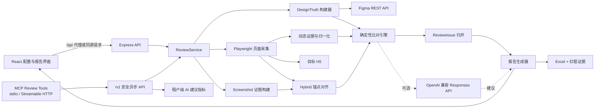

# DiffLab 架构与比对流程

[简体中文](./ARCHITECTURE.md) | [English](./ARCHITECTURE.en.md)

本文描述当前原型的运行组件、数据流、比对算法和已知边界。实现以 `src/` 与 `server/` 中的代码为准。

## 组件概览



| 层 | 主要文件 | 职责 |
| --- | --- | --- |
| 前端 | `src/App.tsx`、`src/styles.css` | 收集输入、编辑规则、调用 API、展示与导出报告 |
| API 适配 | `server/index.ts` | 路由、上传限制和 HTTP 字段到走查输入的转换 |
| 公共 API | `server/public-api.ts` | 服务身份、资产校验、幂等批量、进度/配额、租户隔离、网络策略和签名传输 |
| AI 建议监控 | `server/ai-advice-monitor.ts` | 按租户累计固定拒绝代码、超时率、证据断链率和低基数告警状态 |
| MCP 适配 | `server/mcp.ts`、`server/mcp-stdio.ts`、`server/mcp-http.ts` | 通过 stdio 或无状态 Streamable HTTP，把四个 MCP Review 工具按调用方服务身份转发到 `/v1`，不复制走查逻辑 |
| Webhook | `server/webhook.ts` | 生成固定事件体与 HMAC 签名，执行有上限的指数退避并记录投递结果 |
| 走查服务 | `server/review.ts` | 不依赖 HTTP 地统一编排设计读取、采集、比对、可选 AI 和报告生成 |
| 设计真值 | `server/design.ts` | 从 Figma Frame 构建渲染图、递归节点树、组件/Variant、布局和样式证据 |
| 页面采集 | `server/capture.ts` | 固定浏览器环境、等待页面稳定、截图，并提取 DOM 父子关系、子树签名与静态问题 |
| 截图证据 | `server/screenshot.ts` | 校验 PNG/JPEG/WebP、设备 viewport、DPR、方向和裁剪，并生成多图变化证据 |
| 长截图证据 | `server/long-screenshot.ts`、`server/capture.ts` | 校验有效内容区并按目标 viewport 分片；可选在同一 H5 会话按每片 `scrollY` 采集多帧 DOM/样式证据；记录 document 或唯一主内层滚动容器的请求/实际偏移，滚动目标歧义或未到达时仅把受影响分片降级为 Screenshot；识别吸顶副本、懒加载空白和拼接缝，并把问题汇总回长图绝对坐标 |
| 混合证据 | `server/hybrid.ts` | 用截图视觉锚点与 Live DOM 锚点拟合几何映射，可信时投影 DOM，不可信时降级 |
| 动态证据 | `server/dynamic.ts` | 用多帧轨迹验证单个行情数值，并生成窄范围对称归一化策略 |
| 行情列表 | `server/market-list.ts` | 联合 Figma 表头/行模板层级与重复 DOM 子树，生成模板绑定和确定性列表证据 |
| 行情状态 | `server/market-variant.ts` | 从 Figma 组件证据映射行情 Variant，并检查目标颜色和图标 |
| 规则解析 | `server/default-rules.ts` | YAML 解析、默认值、范围钳制、规则严重级别 |
| 比对引擎 | `server/compare.ts` | 像素差异、节点匹配、属性比较、问题排序 |
| 问题归并 | `server/review-issue.ts` | 按区域、元素和根因归并底层差异，分配优先级并约束 Agent 文案改写 |
| AI 建议 | `server/ai.ts` | 获取模型列表；只向 Responses API 提供最终 ReviewIssue 与已验证的 matched 模块；校验证据引用并由程序组装建议文本 |
| 报告 | `server/report.ts` | 计算最终状态，生成页面数据、Markdown 和独立 HTML |
| Excel 制品 | `server/excel-report.ts` | 按 ReviewIssue 生成红框裁剪图、问题主表、页面对齐证据索引、页面汇总、运行信息和规则快照 |
| 共享模型 | `src/types.ts` | 前后端共用的配置、元素、问题和报告类型 |

## 一次真实比对的生命周期

1. 调用方选择 Live、Screenshot、Hybrid 或 Long Screenshot PagePair；`ReviewService` 与 `/v1` 公共 API 都可批量运行四种模式。截图类输入只引用已校验、同租户的资产。
2. `ReviewService` 解析 YAML。缺失值使用默认配置，数值超出范围时会被钳制；内置 Demo 也调用同一服务。
3. DesignTruth 构建器读取目标 Frame、以 scale 1 渲染 PNG，并保留递归节点树、父子关系、Frame/父节点相对几何、Component/Instance/Variant、Auto Layout、样式证据及 Figma 资源目录。
4. 若规则指定固定 viewport，渲染视口和整棵节点树的两类相对几何按 X/Y 比例缩放。
5. Live 由 Playwright 采集；Screenshot 校验设备元数据并规范化图片；Hybrid 按设备 viewport 采集 H5，再由标题、导航和表头等稳定锚点拟合几何映射；Long Screenshot 按单屏 viewport 分片并保留全页绝对坐标，携带 URL 时逐片形成 Hybrid。长页采集优先使用自然 document 滚动；document 不可达时只接受唯一、占据主要视口的内层纵向滚动容器，并记录请求偏移与实际偏移。多个主候选或未到达目标偏移时不猜测，只把对应分片安全降级为 Screenshot。
6. Live 在同一会话采集 1–5 帧。Screenshot 可接收一张或多张图片；多图只形成变化证据，不会自动忽略无法确认的动态文字。Hybrid 仅在对齐置信度为 high 时投影 DOM，否则降级为 Screenshot。
7. 比对引擎先完成节点匹配，再识别行情列表模板；重复行按列建立模板绑定，复用多帧行情数值归一化和 MarketVariant，并确定性检查表头、列、行、间距、分割线与对齐。
8. 底层差异先归并为 ReviewIssue；同一元素的像素区域可作为确定性问题的关联证据，同一 `PageAlignmentPlan` 模块内的共同位移归并为一个模块根因，不同规则和局部偏移保持独立。Agent 只能改写文案，不能新增无证据参数。
9. 单页报告只根据 `error` 数量确定 `passed` 或 `failed`；批量层把待确认项表达为 `needs_review`，并始终把执行状态与 UI 验收结论分开。
10. Excel 生成器按 ReviewIssue 一行一个修改项，使用同一裁剪范围生成设计/开发红框图，并汇总全部页面、模块对齐证据、运行诊断和生效规则；问题行与对齐行分别公开 `review-issue:*`、`page-alignment:*` 索引，长图行额外记录分片、滚动位置和绝对坐标。

## 可复现的采集环境

每次采集固定以下条件：

- viewport 来自设计图尺寸，或 YAML 中的显式覆盖；
- `deviceScaleFactor: 1`；
- `colorScheme: light`；
- `reducedMotion: reduce`；
- 页面动画、过渡、平滑滚动和光标被 CSS 禁用；
- 只截取当前视口，不截取完整长页面；
- 优先启动本机 Chrome，失败后回退到 Playwright Chromium。

页面在 `domcontentloaded` 后继续等待字体与图片。布局稳定检测最多比较 5 次 DOM 几何快照，每次间隔 `settle_ms`；如果始终变化，采集不会等待“完全稳定”，而是在 `timeout_ms` 总预算内继续生成样本。

默认从同一 browser context、page 和 document 采集 3 帧，间隔由 `sample_interval_ms` 控制。每个元素会生成基于 Figma id 或 DOM 结构的稳定指纹，并保留父选择器、兄弟序号和与文本无关的有限深度子树签名；采集结果同时包含跨帧文字/几何/样式变化摘要与像素方差图。

## 行情列表模板

`server/market-list.ts` 先从 DesignTruth 中识别表头和行模板层级，再要求开发容器中至少出现两个同构直属 DOM 子树。可靠识别后，具体数据、自然排序和合理行数不参与门禁；表头高度、稳定列数、列宽、行高、行间距、分割线和对齐继续确定性比较。每个实际行单元格会绑定到同一 Figma 行模板列，因此行内动态数字复用 `normalize-market-value-text`，行内涨跌状态复用 MarketVariant。

长名称和长数字仍接受 `clipped_text`、`horizontal_overflow` 与列宽规则。只有一个实际行、重复子树不稳定或各行列数不一致时，不应用列表归一化，而是保留普通元素级走查并生成 `market_list_structure/pending`。

## DynamicRegion 验证与 NormalizationPlan

`server/dynamic.ts` 处理已经与 Figma 节点可靠绑定的单个元素，集中完成 DynamicRegion 候选发现、AgentHypothesis Schema 校验和类型化 DeterministicVerifier。候选类型包括行情值、日期时间、倒计时和概率；普通静态文案不会进入 Agent。至少 3 个样本必须证明元素每帧存在、指纹稳定、几何不变且样式不变，设计文字与实际观测还必须属于对应的确定性语义值族。

验证通过后产生精确文字节点范围的 DynamicRegion。`server/normalization-plan.ts` 把所有已验证 DynamicRegion 转成 DeterministicOracle 的属性级比较策略：只有文本字符像素和 `content` 不再可比，位置、尺寸、排版、颜色、装饰、溢出和结构仍继续检查。失败、超时、非法输出或类型冲突保留原始 `content` 问题并降级为 `pending`，不会扩大到父容器、相邻文字或列表。

`ignore` 中的有效选择器在截图前设置为 `visibility: hidden`，并从 DOM 提取与静态审计中排除。无效选择器不会中断任务，只记录诊断。

## 像素比对

参考图和实际截图都被缩放到同一整数 viewport，转成 RGBA 后交给 `pixelmatch`。已验证动态区域会先在设计框和实际框内对称清除，完整差异图用于定位线索，门禁相似度只统计可靠匹配元素中剩余的稳定像素：

- `pixel_threshold` 控制单像素颜色差被判为变化的灵敏度；
- 抗锯齿差异不计入变化；
- `stableSimilarity = 1 - stableChangedPixels / stablePixels`；没有可靠匹配的稳定像素时为 `1`；
- 差异图使用透明背景标记未变化像素；
- 变化像素被放入 24–64 px 的网格，再把八方向相邻网格聚合为区域；变化像素至少 18 个的区域会成为固定 `pending`，其纯视觉推断置信度上限为 `0.70`，最多保留变化像素数最高的 8 个区域。

稳定区域相似度是否触发门禁由 `visual_similarity_min` 与 `rules.visual_similarity` 共同决定。兼容字段 `similarity` 当前等于 `stableSimilarity`，不能把动态区域占比混入该分数。

Screenshot 模式没有 DOM 时以整个设计 Frame 作为像素审查范围；纯视觉区域与 OCR/视觉锚点匹配均受 `0.82` 置信度上限约束，参数问题因此保持 `pending`。Hybrid 的正式实际图始终来自设备截图；投影 DOM 的匹配与参数问题会追加 `geometric-alignment` 依据，并受对齐置信度限制。

## 元素匹配

比对器从 DesignTruth 节点树派生最多 1200 个可比对节点，再按以下顺序一对一匹配 DOM：

1. **精确 id**：`data-figma-id` 与 Figma node id 匹配，`EvidenceConfidence` 为 `0.99`；连字符与冒号会归一化。
2. **稳定文本**：规范化空白和大小写后文本相同，再结合中心点距离、尺寸和类型计算置信度；结果同时记录稳定文本与结构几何依据。
3. **几何启发式**：按中心点距离、尺寸相似度和类型兼容性评分，只接受不低于 `match_confidence_min` 的结果。

精确 ID 与唯一稳定文案先形成确定性模块锚点。当多帧 `elementChanges` 可用时，位移锚点必须在每帧存在，且文字、几何和样式均稳定；轮播、倒计时、实时行情、日期和概率等已知动态语义即使在短采样窗口内暂未变化，也不参与位移估计。若稳定集合内至少有两个标题、表头、导航、卡片或容器锚点，则优先使用这些结构锚点，普通稳定内容只作后备。父模块名为“实时行情”不会使其稳定标题和表头被连带排除。

筛选后的模块锚点使用确定性的 RANSAC 式共识估计：以每个观测位移寻找 `position_tolerance_px` 内的内点，只有严格多数成立才对内点坐标取中位数；没有多数共识时仍可确认模块对应，但不发布 `displacement`，避免单个标题或动态元素带偏模块。每个区域同步输出 `anchorStats`：候选数、稳定数、动态排除数、结构锚点数、RANSAC 内点数和内点相对最终中位位移的 RMS 残差。缺少多帧变化摘要时保持单帧兼容逻辑。

存在未匹配候选且启用 Agent 时，比对器把两张图、候选层级上下文和这些锚点交给模型；模型必须先返回结构化 `PageAlignmentPlan`，再给出元素绑定。计划中的模块状态为 `matched / missing-in-actual / uncertain`，可提出整体位移；确定性复核只接受候选集内的模块和选择器、一对一且不冲突的边界以及不低于 `0.65` 的完整提案，Agent 证据置信度上限为 `0.82`。模型提出的位移不会直接写入最终计划；只有同一 Agent 模块至少两个通过复核且稳定的元素绑定形成内点共识时，才由稳定几何证据重新计算 `displacement`，否则移除位移。

比对器分别记录 Agent 是否已调用、是否成功响应以及哪些业务模块产生了通过复核的绑定。设计侧以根 Frame 下的顶层业务模块为作用域，开发侧父容器作为辅助边界。成功响应但有效绑定为 0 不会全局关闭确定性语义回退：只有设计语义支持动态值、至少 3 帧均存在、文本确实变化且几何与样式稳定的候选，才允许继续接受几何阈值和模块边界复核；静态数字冲突、普通异文案和跨已验证模块边界的候选仍保持未匹配。Agent 有效绑定只让所属模块的剩余异文案候选采用严格模式，不影响兄弟模块的安全动态回退。

Review JSON 的 `matching.semanticAgent` 保存上述状态：全页调用/响应状态、有效绑定总数，以及每个 Agent 已评估顶层模块的有效绑定数、相关开发父容器和动态回退决策。为控制产物体积，每个设计节点只保留几何得分最高候选的决策；`result` 表示该回退是否最终形成匹配，`reasonCode` 区分模块已有有效绑定、设计语义不支持动态值、时序样本不足或不稳定、跨模块边界、几何阈值不足及一对一竞争失败。长截图会合并各分片状态并去重相同决策。

经验证的 `matched` 模块会限制后续元素只能在对应业务区域内匹配；`missing-in-actual` 和有明确边界的子模块 `uncertain` 的子元素不会再被几何兜底强行映射。根 Frame 的 `uncertain` 只作为诊断证据保留，不能升级为全页匹配否决，页面内其他元素仍可进入确定性回退。非法或自相矛盾的结构提案会被拒绝并计入诊断。即使 AI 未启用或失败，确定性模块锚点仍会进入 `PageAlignmentPlan`。

问题归并阶段只使用置信度不低于 `0.8`、带整体位移的 `matched` 模块。至少两个已匹配元素的实际位移必须在 `position_tolerance_px` 内吻合该计划，才会合并成一个模块级 `position` ReviewIssue；原元素问题全部保留在 `evidence`。嵌套 DOM 通过采集到的父链确认归属，嵌套设计模块优先选择路径最具体者。与模块位移不一致的局部位置问题以及尺寸、字体、颜色等其他根因始终独立保留。模块综合置信度低于 `page_alignment.confidence.levels.high_min` 时，合并结果固定降为 `Pending`，不会让 AI 间接改变门禁。

结构完整性采用更窄的例外规则：`missing-in-actual` 必须先通过 Agent 结构提案复核。页面中段的 Figma 区域前后必须各有一个同级、中高置信的稳定 `matched` 模块，且两侧模块的纵向位移阶跃能够解释中间设计流缺口；页首区域可使用 Figma 页面顶部边界与后续同级稳定模块的等量上移作为证据。任何来源为 `agent-verified` 的相邻模块位移都必须至少有两个稳定锚点和两个 RANSAC 内点，否则不会进入 residual 计算，并按缺少对应锚点拒绝候选。尾部候选若缺少普通后置 `matched` 模块，可在最近后续同级模块内使用至少两个跨帧稳定的标题、表头或容器锚点重建后置位移；倒计时、轮播和实时行情值在共识前被排除，重建区域必须达到中置信度，并以 `alignmentRole: missing-module-following-fallback` 标记。水平重叠不足、非同级区域、证据不完整，或残差超过 `max(2 × position_tolerance_px, 设计流缺口 × maximum_residual_ratio)` 时均不发布；水平重叠和残差比例门槛来自 `page_alignment.missing_module`。每个候选的锚点、重叠率、残差、阈值、发布状态和拒绝代码都会写入 `matching.missingModules`；回退证据另记录 `followingAnchorSource` 与 `followingAnchorStats`，用于人工标注和离线校准。通过后生成正式 `missing_module` ReviewIssue，AI 只能引用该问题，不能直接引用原始未匹配区域。页尾缺失在没有额外可复现证据时保持非阻断。

稳定文本和几何候选都必须达到 `match_confidence_min`。匹配后的元素可检查位置、尺寸、文本、字体族/字号/字重/行高、文字对齐、颜色、圆角/边框/透明度。动态行情归一化只跳过具体文本内容，以上参数及裁切溢出仍继续检查。置信度低于 `high_confidence_min` 时，配置为 `error` 或 `warning` 的问题统一降级为 `pending`；`info` 保持原级别。

未匹配的设计节点和开发元素默认不生成问题，也不阻断门禁；上述同级位移、页首边界或时序稳定后置结构锚点证据成立的 `missing_module` 是唯一完整性例外。比对结果和最终报告保留匹配明细、双方未匹配数量及交集覆盖诊断。

AI 汇总位于交集规则之后。`ReviewService` 会移除 `missing-in-actual`、`uncertain`、PageAlignmentPlan 自由摘要、原始比对诊断和两侧图片，只把最终发布的 ReviewIssue 与已验证的 `matched` 区域交给建议模型。模型只返回受 JSON Schema 枚举约束的证据引用；服务端再次校验引用，并从对应 ReviewIssue 的标题、摘要、`primaryAction` 或对齐区域证据组装最终文字。若模型漏选任何阻断级 `missing_module`，服务端会把该正式问题的 `review-issue:*` 引用确定性补入汇总与首要建议，不引入新文案或未验证节点。`createReport` 发布边界还会根据最终问题和带开发选择器的 `matched` 区域重建允许集合；汇总或任一建议缺少引用、引用未知问题或引用非交集区域时，整段 AI 建议从所有产物中移除。报告通过结构化 `aiAdviceRejection` 区分 AI 超时、格式错误、普通生成失败和证据完整性失败；证据失败额外记录断链引用、汇总或从 1 开始的建议位置，同时在诊断中保留可读原因。通过校验的 `summaryEvidenceRefs` 和每条建议的 `evidenceRefs` 会原样进入 Review JSON、Markdown、HTML 和 XLSX，分别以 `review-issue:<id>` 或 `page-alignment:<designParentFigmaNodeId>` 反查证据。因此设计侧未匹配节点不能通过 AI 建议绕过交集匹配边界。公共 `/v1` 结果与 MCP `review.get_result` 透传相同的拒绝结构。

每个匹配和问题都携带结构化 `EvidenceConfidence`：`score`、`level`、`basis` 和本地化 `reasons`。页面模块的分数以原始匹配置信度为上限，并由稳定覆盖率、可用锚点充足度、RANSAC 内点率、残差质量、动态占比和结构锚点支持共同校准；无多数共识或高残差会主动降分。六项权重与 H/M/L 阈值来自 `page_alignment.confidence` 验收规则；输出 `scoreBreakdown` 保留特征值、归一化后权重、贡献和最终分，可直接用于离线标注样本调参。匹配依据区分精确 ID、稳定文本、结构几何和纯视觉推断；确定性全图像素测量和 DOM 静态审计也使用独立依据。

## 报告和门禁

底层问题按 `error → warning → pending → info` 排序后归并为 ReviewIssue，并映射为 `P0 / P1 / P2 / Pending`。最终规则很简单：

```text
errors > 0  => failed
errors == 0 => passed
```

报告中包含：

- 结果 id、时间、耗时、实际证据模式和来源；Hybrid 还包含变换、残差和对齐 EvidenceConfidence；
- 错误/警告/待确认数量、稳定区域相似度、动态区域占比、归一化策略、匹配元素数和双方未匹配数量；
- 参考图、实际图、差异图；
- 每条 ReviewIssue 的优先级、页面位置、主要修改动作、设计值、实际值、结构化 EvidenceConfidence 和可追溯底层证据；
- 实际生效的解析后规则与运行诊断；
- 页面级 `PageAlignmentPlan`，包含模块状态、开发区域、整体位移、判断来源、EvidenceConfidence 和被拒绝提案数；
- 可选 AI 改进建议；建议只引用最终 ReviewIssue 与已验证的 matched PageAlignmentPlan 区域；
- 可直接保存的 Markdown 和独立 HTML。

批量 `Review` 由多个相互独立的 PagePair 组成。单页采集或比对失败只把该页标记为执行失败，其他页面结果仍保留；任务级结果汇总 `passed / failed / needs_review` 页面数和 `P0 / P1 / P2 / Pending` 问题数。统一 Excel 的主表覆盖全部成功页面的问题，页面汇总也记录执行失败页面。

`/v1` 公共 API 使用 Bearer 服务身份和 `reviews:create/read/cancel`、`assets:write`、`metrics:read` 作用域，异步暴露 `queued / running / succeeded / failed / cancelled`。截图上传与 Excel 下载使用短期 HMAC 地址；图片经过类型、字节、哈希、像素与完整解码校验。H5 初始 URL、重定向、浏览器网络请求和 Webhook 目标都会重新检查允许域名与 DNS 解析结果。批量提交支持租户级幂等、全局与租户 Review 并发、跨 Review PagePair 并发预算、有界等待队列、租户提交速率、页面进度、总时限和资源配额；满载时返回 `429` 与 `Retry-After`。Figma、浏览器登录态与 Webhook 密钥均由服务端引用解析。完成页面的 AI 建议结果由独立监控模块按租户累计，并保留最近 15 分钟的有界事件用于本实例 5m/15m 快速观察；`/v1/metrics` 只向当前 Token 暴露固定窗口、固定代码与固定告警类型，不使用 URL、Review、问题或证据值作为标签。生产 Prometheus recording rules 从累计 counter 使用 `increase()` 生成可识别实例重启的 5m/15m 增量，先跨实例汇总窗口计数，再从聚合分子与分母计算比率。抓取健康独立于 Review 流量：`up=1` 表示健康空闲，持续 `up=0` 表示已发现目标抓取失败；由部署侧维护的预期目标清单通过固定选择器的 `absent_over_time()` 检测目标被彻底移出服务发现或 Prometheus 配置。

Review 到达 succeeded、failed 或 cancelled 后可发送签名 Webhook。事件只含稳定任务事实和结果地址；同一事件的重试复用事件 ID，按有上限的指数退避记录每次结果，永久失败不反向改变 Review。

前端导出的 JSON 会移除内嵌图片、HTML 和 Markdown，以减小文件体积。

## 原型边界

- 没有登录态编排、交互脚本、多视口矩阵或历史基线管理；
- DesignTruth 尚未解析 Figma Variables，也不会自动获取资源目录所引用的外部组件完整节点树；
- 样式证据保留原始 style id、paint 和 effect，但确定性规则目前只消费其中已归一化的排版、颜色、边框、圆角、透明度和阴影；
- 截图环境不注入业务字体或请求 mock；公共 Live/Hybrid 可通过服务端 `browserCredentialRef` 注入受控 Headers/Cookies，但不负责交互式登录编排；
- 旧 `/api/compare` 仍只校验 HTTP/HTTPS 协议且无认证，只适合本机原型；`/v1` 已具备服务鉴权和网络访问策略。
- `/v1` 当前使用有界的进程内任务队列、资产、幂等、AI 指标和投递记录；短期地址也由单进程 HMAC 签发。已有单实例调用频率与并发背压，并提供基于 counter `increase()` 的 Prometheus 跨实例聚合规则。Prometheus 能处理已抓取序列的实例重启，但重启前发生且尚未被抓取的增量仍会丢失；持久化队列、对象存储、跨实例任务协调、托管 Prometheus 和生产密钥托管仍属于部署工作。
